# AI 美发店预约助手 💇‍♀️🤖

[**English**](README.md) | **中文**

一个基于 AI 的美发店对话式预约助手。客户像用微信一样打字，AI 自动理解意图、查询可约时段、创建预约、处理取消。内置零配置聊天界面、SQLite 保底存储和受保护的管理后台，开箱即用。

## ✨ 核心功能

- 🤖 **对话式预约** —— 打字就能订位、查时段、取消
- 🌍 **三语界面** —— 英文（默认）/ 中文 / Español 一键切换
- 🔌 **模型无关** —— 兼容任意 OpenAI 标准接口（`/v1/chat/completions`）
- 🛡️ **管理后台** —— 查看/筛选全部预约，`ADMIN_TOKEN` 保护
- ⚡ **无 AI 保底** —— 模型不可用/限流时，快速预约表单仍能落库
- 💾 **零配置存储** —— SQLite，无需外部数据库
- 📅 **Google Calendar** —— 可选集成，日历自动同步

## 📸 效果图

以下截图均为**真实浏览器截图**（非模拟图、非 AI 渲染图）。

### 🤖 AI 对话预约

| 截图 | 说明 |
|---|---|
| 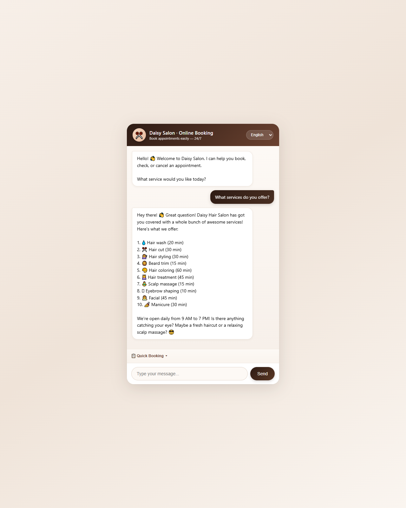 | AI 回复美发店服务菜单 |
| 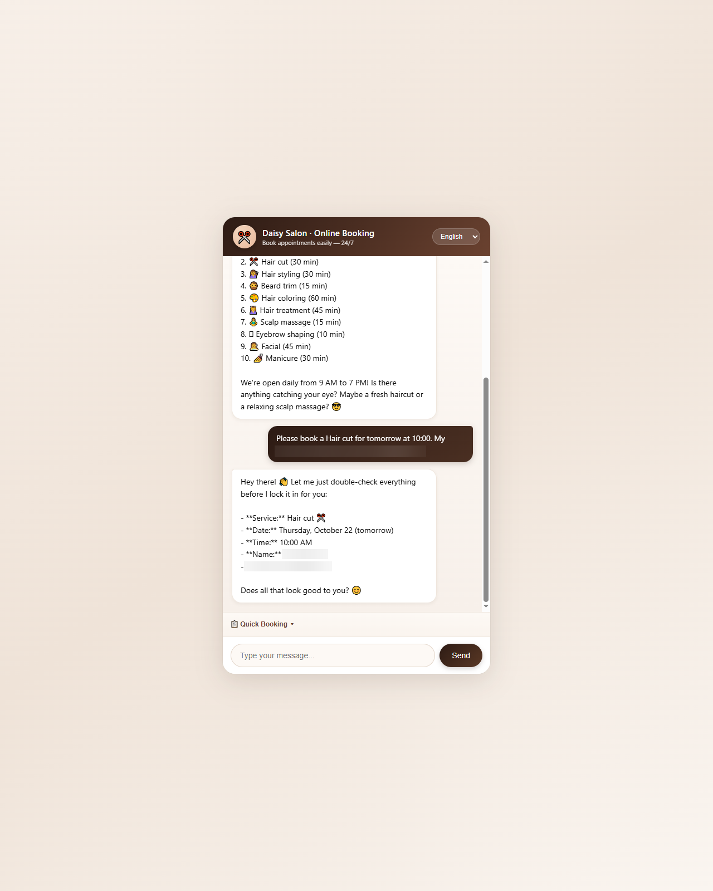 | AI 在对话中收集信息并确认预约 |
| 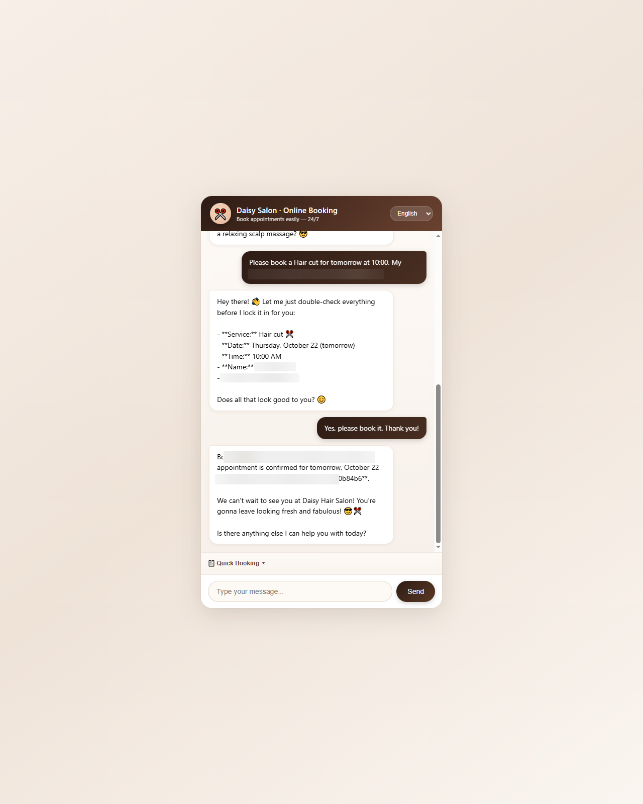 | 预约成功，返回预约码 |
| 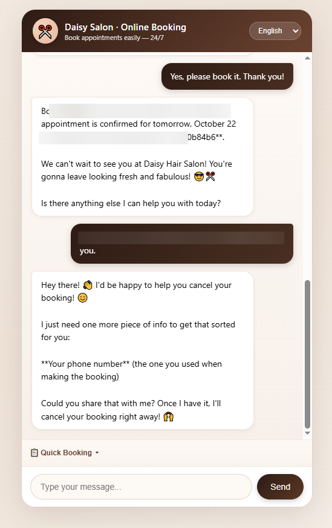 | 客户要求取消预约 |
| 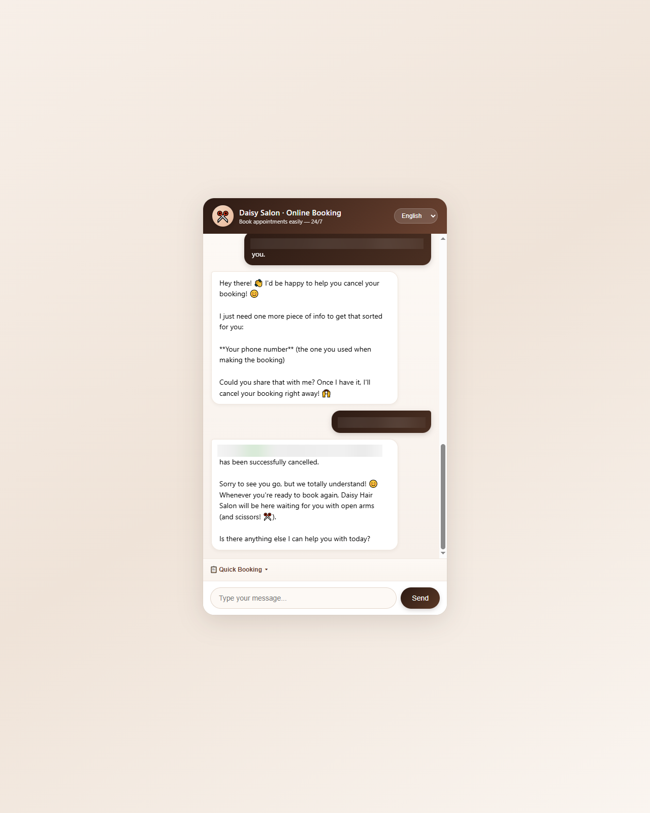 | 取消处理完成 |

### 🌍 三语界面

| 截图 | 说明 |
|---|---|
| 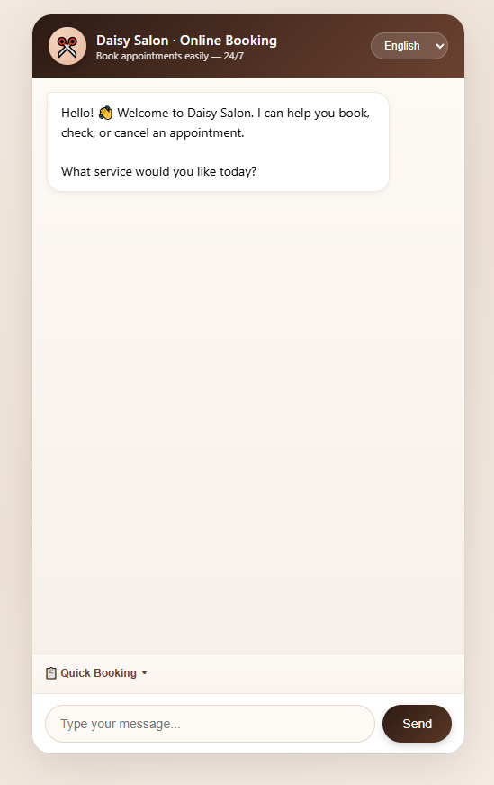 | 英文界面（默认） |
| 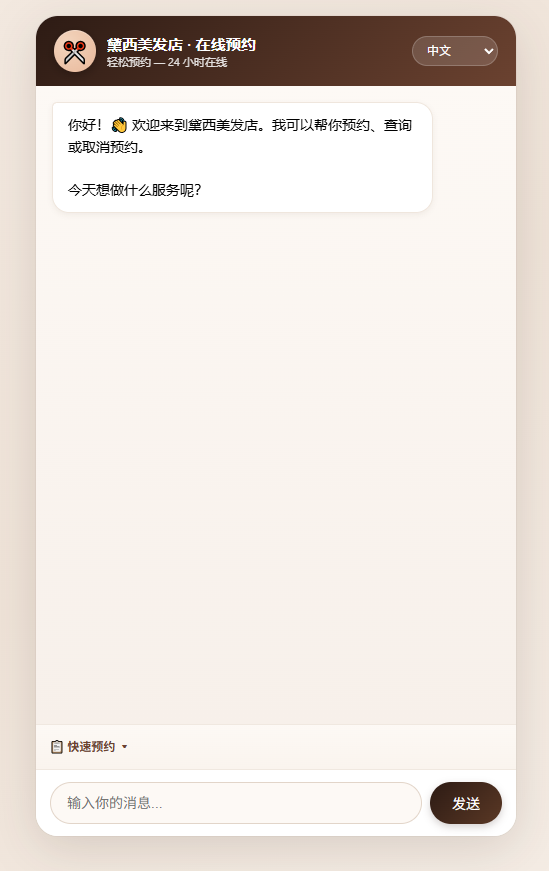 | 中文界面 |
| 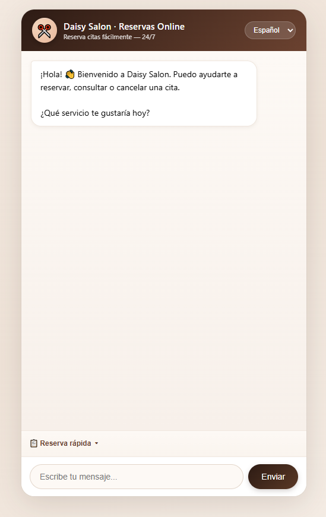 | 西班牙语界面 |

### 🛡️ 保底与管理

| 截图 | 说明 |
|---|---|
| 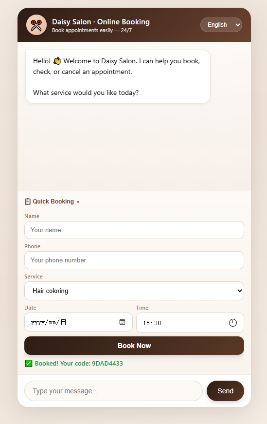 | 无 AI 快速预约表单（保底） |
| 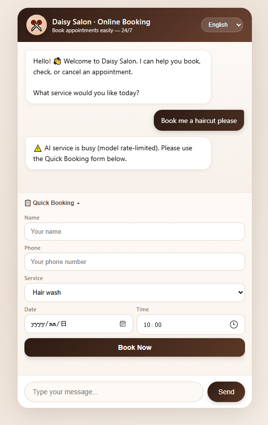 | 降级模式 —— 无 AI 时仍可查看服务 |
| 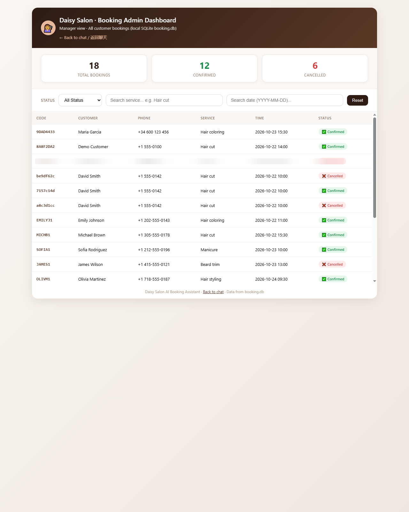 | 管理后台，全部预约一览 |

## 🏗️ 架构

项目采用清晰的四层设计：

```
┌─────────────────────────────────────────────┐
│  Web 层 — FastAPI + 前端                     │
│  /api/chat · /api/booking · /api/health     │
├─────────────────────────────────────────────┤
│  Agent 层 — LangChain Agent                 │
│  BookingAgent + 3 个工具（创建/查时段/取消）    │
├─────────────────────────────────────────────┤
│  模型层 — OpenAI 兼容（任意 /v1 端点）         │
├─────────────────────────────────────────────┤
│  存储层 — SQLite（可选 Google Calendar）      │
└─────────────────────────────────────────────┘
```

### 预约流程

1. 客户在聊天界面输入消息（`POST /api/chat`）。
2. LangChain Agent 调用 LLM 理解意图。
3. Agent 调用工具：
   - `AvailableSlotsTool` —— 查询可约时段
   - `CalendarTool` —— 创建预约
   - `CancelEventTool` —— 取消已有预约
4. 预约写入 SQLite，返回 `booking_code` 给客户。
5. 店主在管理后台（`/bookings`）查看/筛选所有预约。

### 无 AI 保底

当模型不可用或被限流时，前端自动展开**快速预约表单**。`POST /api/booking` 不调用 AI，直接写入 SQLite —— 美发店绝不会漏掉一个预约。

## 🧩 技术栈

- **Python 3.11+**
- **FastAPI** —— Web 框架
- **LangChain** —— Agent + 工具调用
- **OpenAI 兼容模型层** —— 任意 `/v1/chat/completions` 端点
- **SQLite** —— 零配置预约存储
- **Google Calendar API** —— 可选
- **原生 HTML/CSS/JS** —— 三语聊天界面 + 管理后台

## 📁 项目结构

```
hair-salon-assistant/
├── app.py                    # FastAPI 入口 + 全部 API 路由
├── main.py                   # CLI 入口
├── view_bookings.py          # CLI：查看预约
├── run_tests.py              # 测试辅助
├── bookinggpt/
│   ├── agent/
│   │   ├── booking_agent.py  # LangChain Agent（记忆 + 工具）
│   │   └── prompt.py            # 系统提示词
│   ├── tool/
│   │   ├── create_event.py   # 工具：创建预约
│   │   ├── available_event.py# 工具：查询可约时段
│   │   └── cancel_event.py   # 工具：取消预约
│   ├── llm.py                # OpenAI 兼容模型工厂
│   ├── google_auth.py        # Google Calendar OAuth（可选）
│   ├── storage.py            # SQLite 存储
│   └── utils.py
├── templates/
│   ├── index.html            # 三语聊天界面
│   └── admin.html            # 管理后台
├── static/favicon.svg
├── security/                 # Google OAuth 模板（.example）
├── tests/                    # 38 个单元测试
├── docs/                     # 文档 + 真实截图
├── .github/workflows/ci.yml  # CI
└── requirements.txt
```

## 🚀 快速开始

### 1. 克隆并安装依赖

```bash
git clone https://github.com/Liao0429/hair-salon-assistant.git
cd hair-salon-assistant
pip install -r requirements.txt
```

### 2. 配置 `.env`

```bash
# OpenAI 兼容模型
OPENAI_API_KEY=your_key_here
OPENAI_BASE_URL=https://api.openrouter.ai/api/v1   # 或 DeepSeek / 智谱 / 任意
MODEL_NAME=gpt-4o-mini                             # 改成你的模型

# 管理后台（启用 /bookings 需要设置）
ADMIN_TOKEN=your_admin_token
```

可选：复制 `security/credentials.json.example` → `security/credentials.json` 并填入 Google OAuth 凭据，即可启用 Google Calendar 集成。

### 3. 运行 Web 应用

```bash
uvicorn app:app --host 127.0.0.1 --port 8000
```

浏览器打开 http://localhost:8000。

### 4. 运行测试

```bash
pytest
```

## 🔌 API

| 方法 | 路径 | 说明 | 鉴权 |
|---|---|---|---|
| `GET` | `/` | 聊天界面（EN / 中文 / ES） | 无 |
| `POST` | `/api/chat` | 发送消息，返回 AI 回复（限流） | 无 |
| `POST` | `/api/booking` | 快速预约（不调用 AI，写入 SQLite） | 无 |
| `GET` | `/api/health` | 健康检查 | 无 |
| `GET` | `/bookings` | 管理后台（预约列表） | `ADMIN_TOKEN` |

**快速预约** `POST /api/booking`

```json
{ "customer_name": "Emily Johnson", "phone": "+1 555-0100", "service": "Hair cut", "date": "2026-10-25", "time": "14:00" }
```

响应：

```json
{ "booking_code": "A1B2C3D4", "status": "confirmed" }
```

**管理后台**：启动前设置 `ADMIN_TOKEN`，访问 `/bookings?token=<值>`。未设置 `ADMIN_TOKEN` 返回 503，token 错误返回 401。

## 🔒 安全说明

- `.env`、`security/credentials.json`、`security/token.json`、`booking.db` 均已被 `.gitignore` 排除，不会入库。
- 仓库只包含 `.env.example` 与 `security/*.example` 模板，无任何真实密钥/token。
- 管理后台受 `ADMIN_TOKEN` 保护，部署到公网前务必设置。

## ⚙️ CI

GitHub Actions 在每次推送时自动运行 `pytest`（`.github/workflows/ci.yml`）。

## ✅ 验证记录（2026-10-21）

- **环境**：Python 3.12 venv，依赖已安装
- **模型**：任意 OpenAI 兼容端点（示例使用 `gpt-4o-mini`）
- **结果**：助手可列出服务清单、引导客户提供预约信息、调用工具订位/查时段/取消
- **测试**：`pytest` 38 项全部通过

## 📄 许可

MIT License。见 [LICENSE](LICENSE)。
